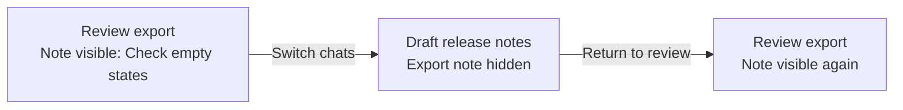

# Scratchpad

**Floating Markdown notes for macOS that follow the work you're doing.**

Keep a checklist, a snippet, or a reminder visible while you work. Bind it to a Codex chat or Claude Code session, and it comes back when you return to that task.

*Example of a note bound to a Codex chat or a Claude Code session.*

## What it does

- **Capture a thought.** Press `⌥⇧1` to open a Markdown editor. Press it twice in quick succession to pin text from the clipboard.
- **Pin it above your work.** Keep a compact note on screen while you type in another app. Open the pin again whenever you need to edit it.
- **Keep context with the task.** A bound note follows its Codex chat or Claude Code session. Leave a note unbound to keep it visible as you switch tasks.

## Status

Built for Apple silicon Macs running macOS 15 or later. This repository is the public project showcase. The app's source code is private, and a public download is not available yet.

If you use floating notes while coding, [share what you would pin](https://github.com/karimpanch/scratchpad/issues/new) or tell me where your current workflow gets in the way.
